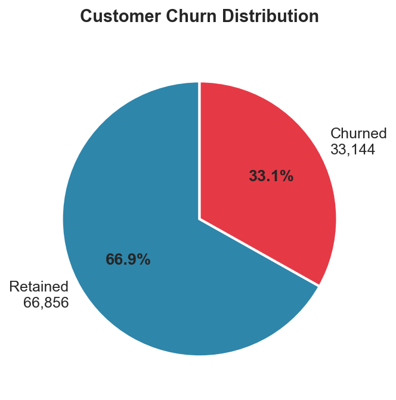
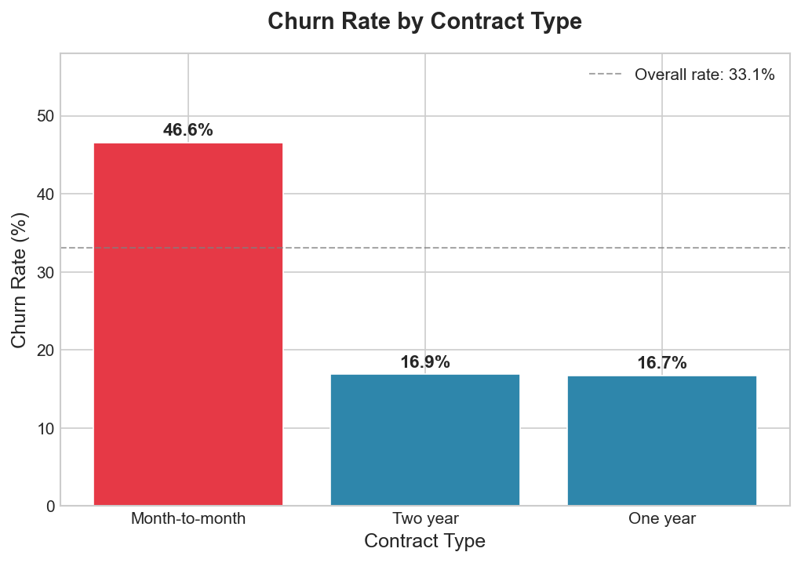
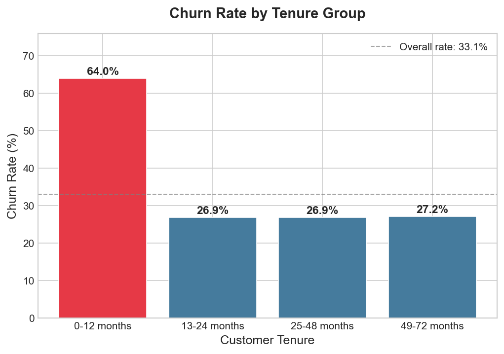
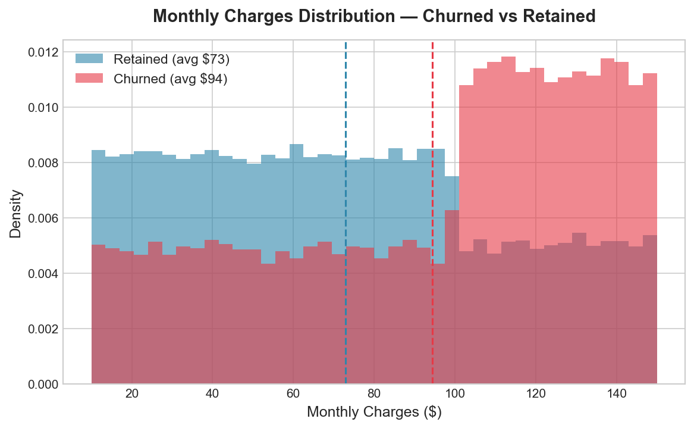
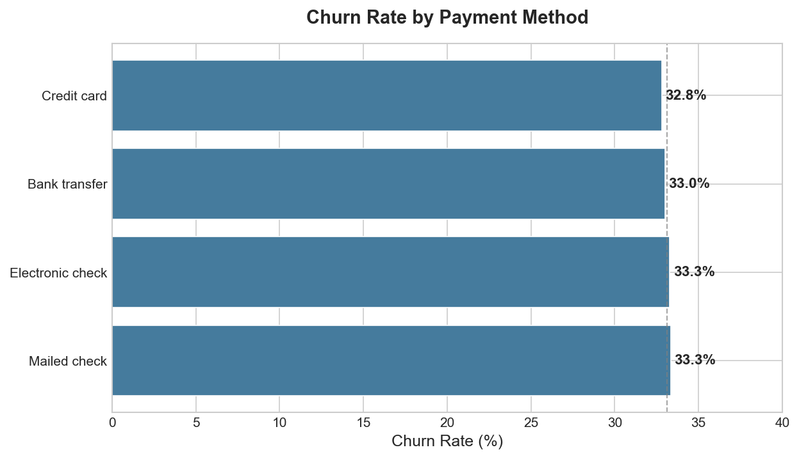
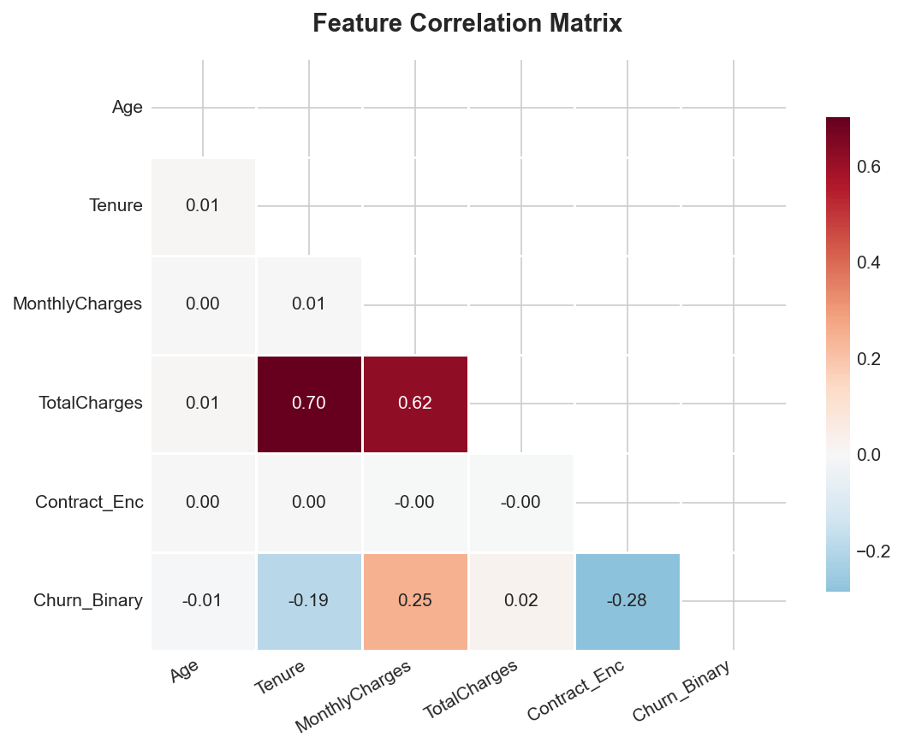
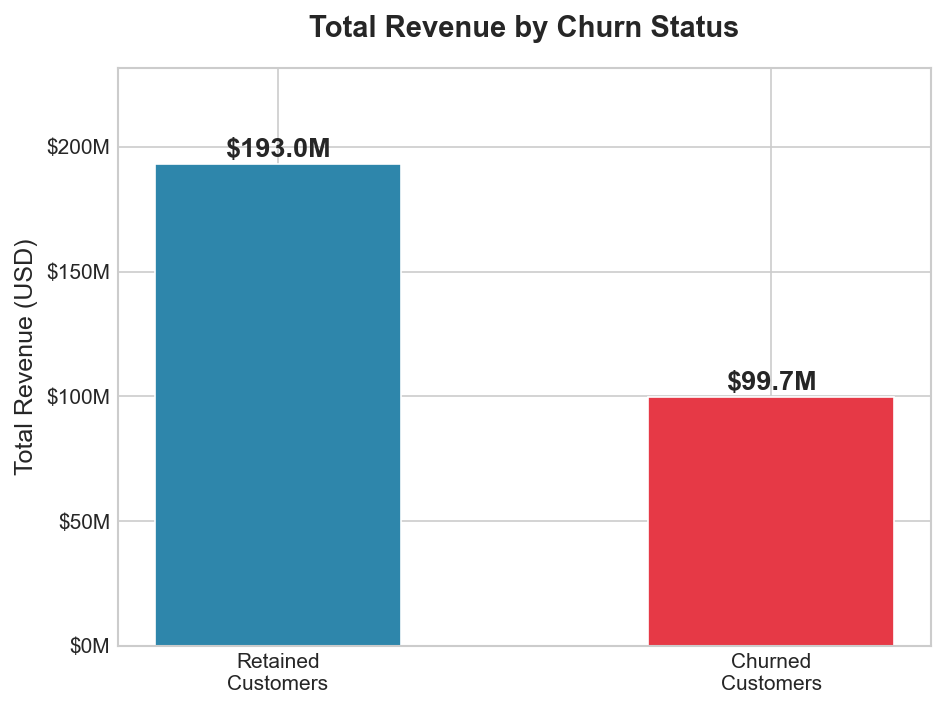
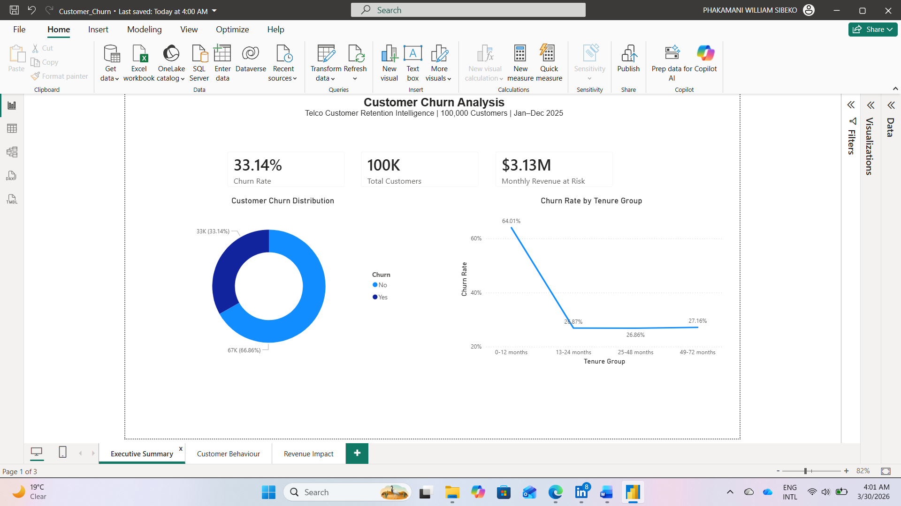
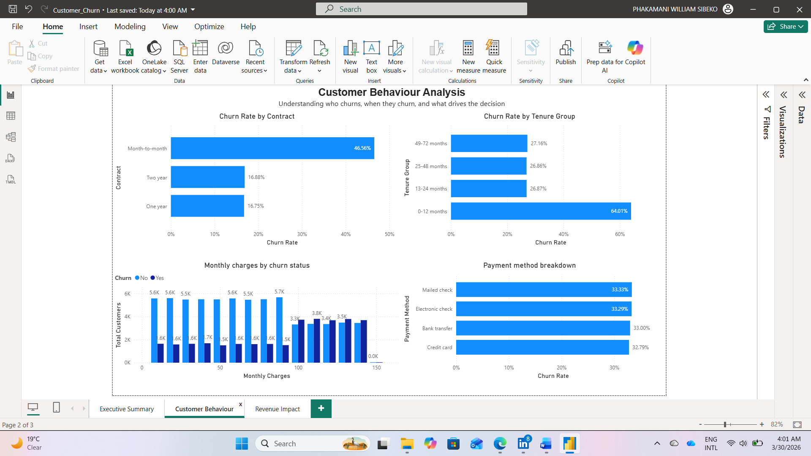
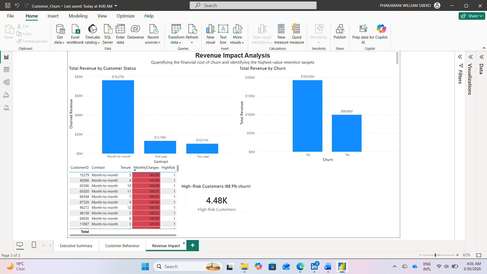

# Customer Churn Analysis — End-to-End Data Analytics Project

## Business Problem

Customer churn is one of the most financially damaging challenges in subscription-based businesses. Acquiring a new customer costs 5–7× more than retaining an existing one. Every churned customer represents not just lost historical revenue — but a recurring gap that must be filled through new acquisition each month just to stay flat.

This project answers three core business questions:

1. **Who is churning?** Which customer segments are at highest risk?
2. **Why are they churning?** Which factors actually predict churn vs which ones don't?
3. **What should the business do?** Where should retention investment be focused for maximum impact?

---

## Project Architecture

```
Raw CSV (100K rows)
       │
       ▼
Phase 1 — Python     →  Data cleaning, EDA, feature engineering, visualisations
       │
       ▼
Phase 2 — SQL        →  10 business queries, revenue impact, risk segmentation
       │
       ▼
Phase 3 — Power BI   →  3-page executive dashboard, DAX measures, storytelling
```

---

## Dataset

| Attribute | Detail |
|---|---|
| Source | Kaggle — Synthetic Telco Customer Churn Dataset |
| Records | 100,000 customers |
| Raw features | CustomerID, Age, Gender, Tenure, MonthlyCharges, Contract, PaymentMethod, TotalCharges, Churn |
| Engineered features | TenureGroup, AvgMonthlySpend, HighRisk flag, AgeGroup, encoded columns |
| Target variable | Churn (Yes / No) → encoded as Churn_Binary (1 / 0) |

---

## Phase 1 — Python: Data Cleaning & EDA

### Data Quality Assessment

```
Records loaded      : 100,000
Columns             : 9
Duplicate rows      : 0
Duplicate CustomerID: 0
Missing values      : None — dataset is complete
Negative TotalCharges: 265 records (corrected)
TotalCharges outliers: 841 (retained — high-tenure, high-spend customers)
```

**Data issue found and fixed:** 265 records contained negative TotalCharges values — likely sign-entry errors during data generation. These were corrected by converting to absolute values. No records were dropped.

### Feature Engineering

| Feature | Logic | Business purpose |
|---|---|---|
| `TenureGroup` | Binned: 0-12, 13-24, 25-48, 49-72 months | Lifecycle stage analysis |
| `AvgMonthlySpend` | TotalCharges ÷ Tenure | Normalised per-month spending |
| `HighRisk` | Month-to-month + Tenure ≤ 12 + above-median charges | Rule-based churn risk flag |
| `AgeGroup` | Binned: 18-30, 31-45, 46-60, 61-80 | Demographic segmentation |

### Outlier Detection (IQR Method)

| Column | Outliers | Q1 | Q3 | IQR |
|---|---|---|---|---|
| Age | 0 | 33.0 | 65.0 | 32.0 |
| Tenure | 0 | 18.0 | 54.0 | 36.0 |
| MonthlyCharges | 0 | 44.7 | 115.1 | 70.3 |
| TotalCharges | 841 | 963.7 | 4,394.3 | 3,430.7 |

TotalCharges outliers are expected — they represent long-tenure, high-spend customers and were retained in the analysis.

---

## EDA — Exploratory Data Analysis

### Churn Distribution



**33,144 of 100,000 customers churned — a 33.1% churn rate.**

One in three customers is leaving. In subscription businesses, healthy annual churn sits below 5–7%. A 33% rate signals a structural retention problem. The business is effectively replacing one third of its customer base each cycle — creating a permanent acquisition burden just to maintain flat revenue.

At $3.13M in monthly charges from churned customers, the business must generate this amount in new customer revenue every month before it can grow.

---

### Churn Rate by Contract Type



**Month-to-month customers churn at 46.6% — nearly 3× the rate of annual contract holders.**

| Contract | Customers | Churned | Churn Rate |
|---|---|---|---|
| Month-to-month | 54,915 | 25,567 | **46.6%** |
| Two year | 19,824 | 3,346 | 16.9% |
| One year | 25,261 | 4,231 | 16.7% |

The critical observation: average monthly charges are nearly identical across all three contract types (~$80/month). **Price is not the differentiator — commitment is.** Customers on short contracts have no lock-in, and nearly half leave.

Contract type is the strongest single predictor of churn in this dataset (correlation = −0.28). Converting month-to-month customers to annual plans is the highest-ROI retention lever available.

---

### Churn Rate by Tenure Group



**The first 12 months are the crisis point — 64% of new customers churn before their first anniversary.**

| Tenure Group | Customers | Churned | Churn Rate |
|---|---|---|---|
| 0-12 months | 16,647 | 10,655 | **64.0%** |
| 13-24 months | 16,637 | 4,471 | 26.9% |
| 25-48 months | 33,332 | 8,952 | 26.9% |
| 49-72 months | 33,384 | 9,066 | 27.2% |

After month 12, churn drops sharply to ~27% and **stays flat for the next 5 years**. A customer who survives their first year is statistically very likely to remain long-term. The data is unambiguous: this is not a retention problem across the customer lifecycle. It is an **onboarding problem** concentrated in year one.

The SQL window function analysis (Q10) confirmed this precisely — monthly churn runs at 67–68% every single month from month 1 through month 11, then falls to 26.7% at month 12. **Month 11 is the intervention deadline.**

---

### Monthly Charges Distribution — Churned vs Retained



**Churned customers pay significantly more — $94.36/month vs $72.85 for retained customers.**

The distribution shows churned customers clustering in the $80–$150 range while retained customers are more evenly spread toward lower charges. This is counterintuitive but common in telecoms.

**Higher-paying customers are not leaving because they cannot afford the service — they are leaving because they do not perceive value proportional to what they are paying.** The business is losing its most valuable customers first.

Proactive outreach to customers paying above $80/month at the 6-month mark — before dissatisfaction becomes a decision — is a direct response to this finding.

---

### Churn Rate by Payment Method



**Payment method does not predict churn. All four methods sit within 0.5% of each other.**

| Payment Method | Customers | Churned | Churn Rate |
|---|---|---|---|
| Mailed check | 25,221 | 8,407 | 33.3% |
| Electronic check | 34,892 | 11,615 | 33.3% |
| Bank transfer | 19,855 | 6,553 | 33.0% |
| Credit card | 20,032 | 6,569 | 32.8% |

This is a deliberate null finding. Payment friction is frequently cited as a churn driver in telecoms. This data rules it out entirely. **Knowing what does not matter is as valuable as knowing what does** — it prevents the business from investing in payment process improvements that will not move the churn metric.

---

### Feature Correlation Matrix



| Feature | Correlation with Churn | Interpretation |
|---|---|---|
| Contract_Enc | −0.28 | Strongest predictor — higher contract = less churn |
| MonthlyCharges | +0.25 | Higher charges = more churn |
| Tenure | −0.19 | Longer tenure = less churn |
| TotalCharges | +0.02 | Weak — driven by MonthlyCharges × Tenure |
| Age | −0.006 | Effectively no relationship |

Age and gender are not meaningful churn predictors. Demographic-based segmentation will not improve retention outcomes. Focus belongs on structural variables: contract type, tenure stage, and monthly charges.

---

### Revenue Impact



**$99.7M of the $292.6M total revenue — 34.1% — came from customers who churned.**

| Customer Status | Customers | Total Revenue | Avg Monthly Charge |
|---|---|---|---|
| Retained | 66,856 | **$193.0M** | $72.85 |
| Churned | 33,144 | **$99.7M** | $94.36 |

The churned bar being 34% of total revenue while representing 33% of customers confirms something important: churned customers were slightly more valuable per head ($3,007 avg total charges vs $2,886 for retained). The business lost its higher-spending segment disproportionately.

---

## Phase 2 — SQL Business Analysis

All queries run against `cleaned_churn_data.csv` imported into SQLite.

### Q1 — Overall Churn Rate

```sql
SELECT
    COUNT(*)                                AS total_customers,
    SUM(Churn_Binary)                       AS churned_customers,
    COUNT(*) - SUM(Churn_Binary)            AS retained_customers,
    ROUND(AVG(Churn_Binary) * 100.0, 2)    AS churn_rate_pct,
    ROUND((1 - AVG(Churn_Binary)) * 100.0, 2) AS retention_rate_pct
FROM customer_churn;
```

| Total customers | Churned | Retained | Churn rate | Retention rate |
|---|---|---|---|---|
| 100,000 | 33,144 | 66,856 | **33.14%** | 66.86% |

---

### Q2 — Churn by Contract Type

| Contract | Customers | Churned | Churn Rate | Avg Monthly | Total Revenue |
|---|---|---|---|---|---|
| Month-to-month | 54,915 | 25,567 | **46.56%** | $79.99 | $160.8M |
| Two year | 19,824 | 3,346 | 16.88% | $79.82 | $57.7M |
| One year | 25,261 | 4,231 | 16.75% | $80.06 | $74.1M |

Monthly charges are near-identical across all contracts. The 30-point churn gap between month-to-month and annual contracts is driven entirely by commitment level, not price.

---

### Q3 — Churn by Tenure Group

| Tenure Group | Customers | Churned | Churn Rate | Avg Monthly |
|---|---|---|---|---|
| **0-12 months** | 16,647 | 10,655 | **64.01%** | $79.63 |
| 13-24 months | 16,637 | 4,471 | 26.87% | $79.89 |
| 25-48 months | 33,332 | 8,952 | 26.86% | $79.77 |
| 49-72 months | 33,384 | 9,066 | 27.16% | $80.40 |

The first-year cliff is not a gradual decline — it is a sharp drop that happens precisely between month 11 and month 12, confirmed by the window function in Q10.

---

### Q4 — Churn by Payment Method

| Payment Method | Customers | Churned | Churn Rate |
|---|---|---|---|
| Mailed check | 25,221 | 8,407 | 33.33% |
| Electronic check | 34,892 | 11,615 | 33.29% |
| Bank transfer | 19,855 | 6,553 | 33.00% |
| Credit card | 20,032 | 6,569 | 32.79% |

All within 0.54% of each other. Null finding confirmed by SQL.

---

### Q5 — Revenue Impact of Churn

| Status | Customers | Total Revenue | Avg per Customer | Avg Monthly | Monthly Impact |
|---|---|---|---|---|---|
| Retained | 66,856 | $193.0M | $2,886 | $72.85 | $4.87M |
| **Churned** | 33,144 | **$99.7M** | $3,007 | **$94.36** | **$3.13M** |

Churned customers had a higher average total charges ($3,007 vs $2,886) — confirming the business lost disproportionately valuable customers.

---

### Q6 — High-Risk Segment Deep Dive (Month-to-month, 0-12 months)

| Spend Tier | Customers | Churned | Churn Rate | Avg Monthly | Monthly Revenue at Risk |
|---|---|---|---|---|---|
| **High (≥$100)** | 3,225 | 3,132 | **97.12%** | $124.96 | $403K |
| Mid ($60–$99) | 2,627 | 1,767 | 67.26% | $79.45 | $209K |
| Low (<$60) | 3,296 | 2,194 | 66.57% | $35.11 | $116K |

The high-spend tier within the high-risk segment has a **97.12% churn rate** — virtually certain to churn. At $124.96/month average, each saved customer in this group preserves ~$1,500/year.

---

### Q7 — HighRisk Flag Validation

| Risk Flag | Customers | Churned | Churn Rate | Avg Monthly | Monthly Revenue at Risk |
|---|---|---|---|---|---|
| **High risk (1)** | 4,481 | 3,983 | **88.89%** | $115.12 | $516K |
| Standard (0) | 95,519 | 29,161 | 30.53% | $78.33 | $7.48M |

The rule-based HighRisk flag captures 4,481 customers with an 88.89% churn rate — validating it as operationally deployable. The flag identifies the right customers precisely enough to serve as a CRM outreach trigger.

---

### Q8 — Age Group Analysis (Null Finding)

| Age Group | Customers | Churned | Churn Rate | Avg Monthly |
|---|---|---|---|---|
| 18–30 | 20,483 | 6,893 | 33.65% | $79.46 |
| 31–45 | 24,083 | 7,975 | 33.11% | $80.36 |
| 46–60 | 23,576 | 7,860 | 33.34% | $79.55 |
| 61–80 | 31,858 | 10,416 | 32.70% | $80.33 |

All age groups within 0.95% of each other. Age is not a churn predictor — confirmed by both SQL and correlation analysis (−0.006). Demographic segmentation will not improve retention outcomes.

---

### Q9 — Contract Upgrade Opportunity (Revenue Case)

| MTM Churned | Monthly Rev Lost | Avg Monthly | Annual Contract Churn Rate | Est. Monthly Revenue Saved |
|---|---|---|---|---|
| 25,567 | $2.31M | $90.24 | 16.81% | **$1.92M** |

If month-to-month churners were on annual contracts and churned at the annual rate of 16.81%, the business would save an estimated **$1.92M/month**. This is the financial case for investing in contract migration incentives. Even achieving 50% conversion would represent a $960K/month improvement.

---

### Q10 — Running Churn by Tenure (Window Function)

This query reveals the exact shape of the early-churn cliff:

| Month | Customers | Churned | Monthly Churn Rate | Cumulative Churn Rate |
|---|---|---|---|---|
| 1 | 1,398 | 953 | **68.17%** | 68.17% |
| 6 | 1,405 | 951 | **67.69%** | 67.11% |
| 12 | 1,391 | 371 | **26.67%** | 64.01% |
| 13 | 1,359 | 362 | 26.64% | 61.19% |
| 18 | 1,405 | 366 | 26.05% | 51.58% |
| 24 | 1,331 | 336 | 25.24% | 45.45% |

**Monthly churn runs at 67–68% every month from month 1 through month 11, then drops to 26.67% at month 12 and stays near that level permanently.**

The cliff is exact, not gradual. This aligns precisely with the annual contract renewal point — customers who have not committed to a longer contract are leaving every month at an extraordinary rate throughout year one. Month 11 is the last actionable window for intervention before customers make their exit decision.

---

## Phase 3 — Power BI Dashboard

Three-page interactive dashboard built in Power BI Desktop.

### Page 1 — Executive Summary



**KPI Cards:**
- Churn Rate: **33.14%**
- Total Customers: **100K**
- Monthly Revenue at Risk: **$3.13M**

**Visuals:** Customer Churn Distribution (donut) · Churn Rate by Tenure Group (line chart)

The executive page answers the top-level question in three numbers and shows the tenure cliff that explains where the problem is concentrated. A business leader reading this page should leave with two facts: one in three customers is leaving, and the problem is overwhelmingly concentrated in year one.

---

### Page 2 — Customer Behaviour



**Visuals:** Churn Rate by Contract Type · Churn Rate by Tenure Group · Monthly Charges Distribution · Payment Method Breakdown

This page separates the predictors from the noise. Contract type and tenure stage drive churn. Payment method and age do not. The payment method chart — all bars nearly equal — is as important as the contract type chart. It tells the business where not to spend money.

---

### Page 3 — Revenue Impact



**Visuals:** Total Revenue by Churn Status · Churned Revenue by Contract · High-Risk Customers card (4.48K) · High-Risk Customer Table

This page translates the churn statistics into dollar amounts and a prioritised action list. The $99.7M churned revenue figure and the 4,481-row high-risk table are the two outputs most likely to drive a business decision. Month-to-month contracts account for 76.5% of all churned revenue — making the contract migration business case self-evident.

### DAX Measures

```dax
Churn Rate =
DIVIDE(
    CALCULATE(COUNTROWS(customer_churn), customer_churn[Churn] = "Yes"),
    COUNTROWS(customer_churn)
)

Total Customers = COUNTROWS(customer_churn)

Total Revenue = SUM(customer_churn[TotalCharges])

Churned Revenue =
CALCULATE(
    SUM(customer_churn[TotalCharges]),
    customer_churn[Churn] = "Yes"
)

Monthly Revenue at Risk =
CALCULATE(
    SUM(customer_churn[MonthlyCharges]),
    customer_churn[Churn] = "Yes"
)

High Risk Customers =
CALCULATE(
    COUNTROWS(customer_churn),
    customer_churn[HighRisk] = 1
)
```

---

## Key Findings Summary

| Finding | Metric | Business implication |
|---|---|---|
| Overall churn rate | 33.14% | 1 in 3 customers lost — structural problem |
| Month-to-month churn | 46.56% | Nearly 3× annual contract churn rate |
| First-year churn | 64.0% | Drops to 27% after month 12 and stays flat |
| Monthly churn cliff | Month 12 | 68% → 27% drop between month 11 and 12 |
| Avg monthly charge — churned | $94.36 vs $72.85 retained | Business losing highest-paying customers |
| Total churned revenue | $99.7M (34.1% of total) | Direct revenue exposure quantified |
| Monthly revenue at risk | $3.13M/month | Acquisition cost just to stay flat |
| Contract upgrade opportunity | $1.92M/month recoverable | Financial case for migration incentives |
| High-risk segment | 4,481 customers · 88.9% churn | Actionable CRM target list |
| Payment method | All within 0.54% | Not a predictor — deprioritise |
| Age | Correlation = −0.006 | Not a predictor — deprioritise |

---

## Recommendations

**1. Contract migration programme (highest ROI)**
Month-to-month customers churn at 46.6% vs 16.8% for annual contracts. SQL Q9 estimated $1.92M/month in recoverable revenue if churning month-to-month customers were on annual plans. Offer a time-limited incentive — one free month, discounted first year, or feature upgrade — to migrate month-to-month customers at the 6-month mark. Priority target: customers in the high-risk segment.

**2. Structured 90-day onboarding programme**
64% of first-year customers churn, and monthly churn runs at 67–68% every month through month 11. This indicates customers are not finding sufficient value before their first renewal decision. Proactive outreach at 30, 60, and 90 days — checking activation, usage, and satisfaction — would directly address the largest churn driver. The goal is simply to get customers to month 13.

**3. Proactive outreach to high-spend customers at month 6**
Churned customers pay $21.51/month more than retained ones on average. The business is losing premium-paying customers. An outreach programme targeting customers paying above $80/month at the 6-month mark — before dissatisfaction becomes a churn decision — would address the most valuable at-risk segment.

**4. Deploy the HighRisk flag in CRM**
The 4,481 customers flagged as high-risk churn at 88.9%. This is a precise, actionable cohort ready to be loaded as a CRM trigger for automated retention workflows: outreach call, upgrade offer, or account review. At $115/month average, each saved customer preserves ~$1,380/year.

**5. Deprioritise payment method and age in churn modelling**
Both are statistically weak predictors. SQL confirmed all four payment methods sit within 0.54% churn rate of each other. Removing these variables simplifies retention models without losing accuracy and redirects investment toward variables that actually matter.

---

## Limitations

- Dataset is synthetic — findings should be validated against real business data before operational deployment
- No product usage data — engagement signals, support tickets, and feature adoption cannot be assessed
- No acquisition channel data — cost-per-acquisition and channel-specific lifetime value analysis not possible
- TotalCharges is cumulative historical revenue, not a forward-looking projection
- The HighRisk flag is rule-based (3 criteria) — a logistic regression or gradient boosting model would improve precision and recall
- No geographic data — regional churn variation cannot be assessed
- No cost or margin data — revenue figures do not reflect profitability

---

## Project Structure

```
customer-churn-analysis/
│
├── data/
│   ├── synthetic_customer_churn_100k.csv   
│   └── cleaned_churn_data.csv               
│
├──churn_analysis.py                  
│
├── churn_analysis.sql                   
│
├── images/
│   ├── 01_churn_distribution.png
│   ├── 02_churn_by_contract.png
│   ├── 03_churn_by_tenure.png
│   ├── 04_monthly_charges_distribution.png
│   ├── 05_churn_by_payment.png
│   ├── 06_correlation_heatmap.png
│   ├── 07_revenue_impact.png
│   ├── powerbi_page1.png
│   ├── powerbi_page2.png
│   └── powerbi_page3.png
│
├── Customer_Churn.pbix                      
└── README.md
```
