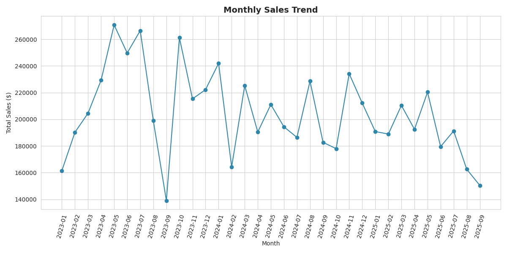
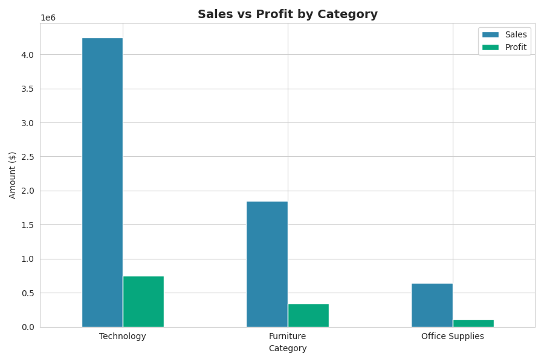
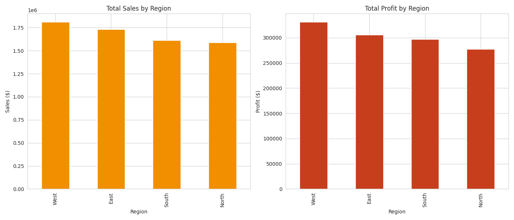
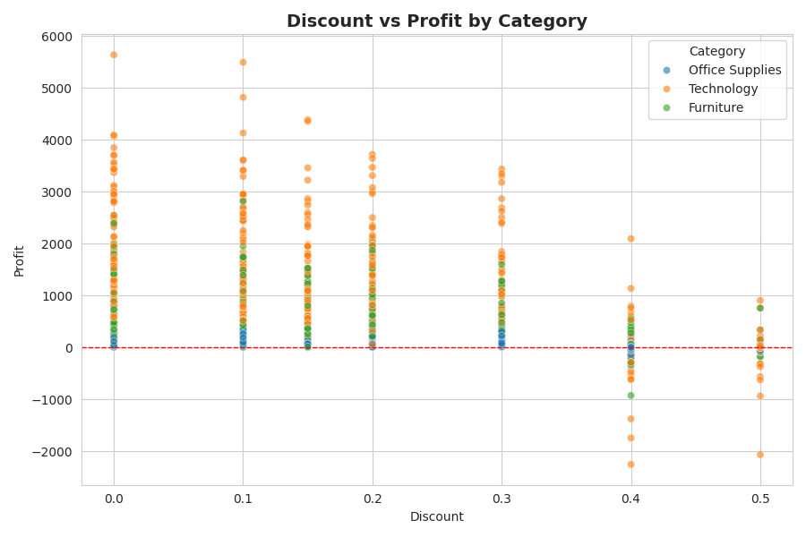
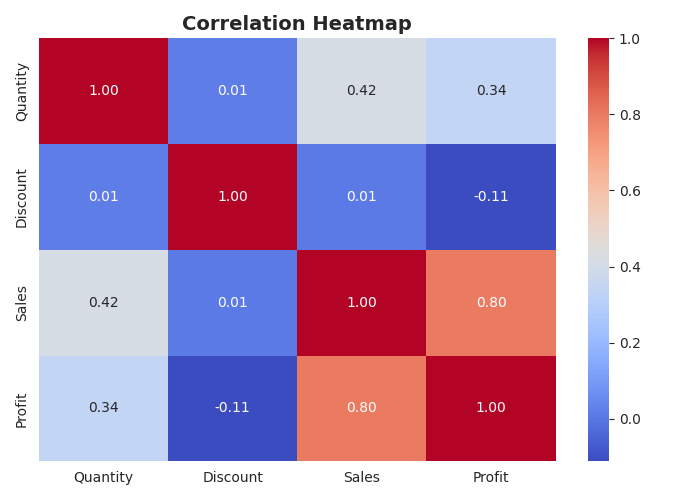
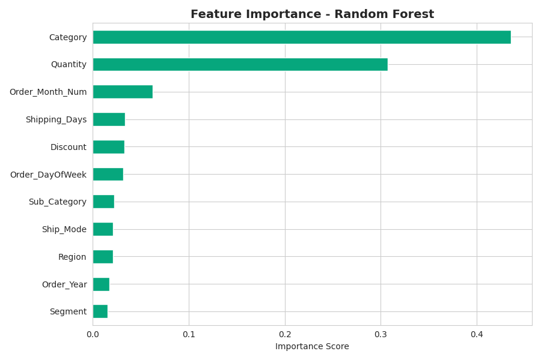
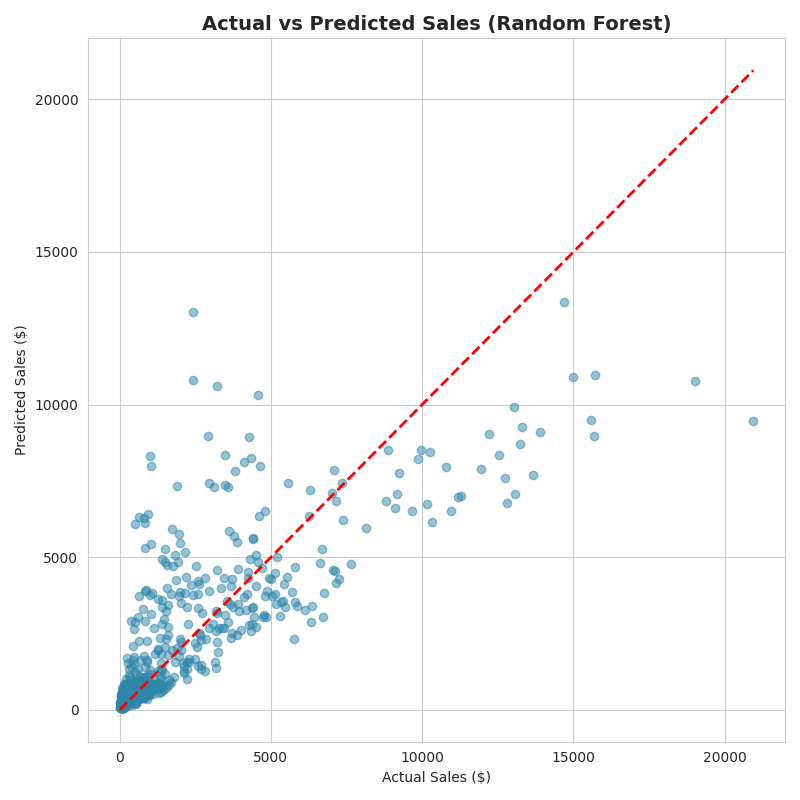

# 🛍️ Retail Sales Analysis

An end-to-end data science project on a retail sales dataset — covering data cleaning, exploratory data analysis (EDA), feature engineering, and machine learning–based sales prediction, with full visualizations and business insights.

---

## 📑 Table of Contents

- [Overview](#-overview)
- [Dataset](#-dataset)
- [Project Structure](#-project-structure)
- [Installation](#-installation)
- [Usage](#-usage)
- [Workflow](#-workflow)
- [Key Visualizations](#-key-visualizations)
- [Model Performance](#-model-performance)
- [Business Insights](#-business-insights)
- [Tech Stack](#-tech-stack)
- [Future Improvements](#-future-improvements)
- [License](#-license)

---

## 📋 Overview

This project simulates a real-world retail analytics workflow: a company wants to understand its sales performance and forecast future sales based on historical order data. The notebook walks through the complete pipeline — from raw, messy data to a trained and evaluated machine learning model.

**Goals:**
- Clean and prepare raw retail transaction data
- Explore sales trends across time, category, region, and customer segment
- Engineer features suitable for machine learning
- Build and compare regression models to predict `Sales`
- Translate model results into actionable business recommendations

---

## 📊 Dataset

A Superstore-style retail transactions dataset (`data/retail_sales_data.csv`) containing **3,000+ orders** with the following fields:

| Column | Description |
|---|---|
| `Order_ID` | Unique order identifier |
| `Order_Date` / `Ship_Date` | Order and shipping dates |
| `Ship_Mode` | Standard / Second / First Class / Same Day |
| `Region` | North, South, East, West |
| `Segment` | Consumer, Corporate, Home Office |
| `Category` / `Sub_Category` | Product classification |
| `Quantity` | Units ordered |
| `Discount` | Discount applied (0–50%) |
| `Sales` | Order revenue ($) |
| `Profit` | Order profit ($) |

The raw data intentionally includes missing values and duplicate rows to demonstrate real-world data cleaning.

---

## 📁 Project Structure

```
retail-sales-analysis/
│
├── data/
│   └── retail_sales_data.csv          # Raw dataset
│
├── notebooks/
│   └── Retail_Sales_Analysis_Prediction.ipynb   # Full analysis + ML pipeline
│
├── images/
│   ├── monthly_sales_trend.png
│   ├── category_sales_profit.png
│   ├── region_performance.png
│   ├── subcategory_sales.png
│   ├── discount_vs_profit.png
│   ├── correlation_heatmap.png
│   ├── segment_distribution.png
│   ├── actual_vs_predicted.png
│   └── feature_importance.png
│
│
├── requirements.txt
├── .gitignore
├── LICENSE
└── README.md
```

---

## 🔄 Workflow

1. **Data Cleaning** — handled missing `Discount` values, removed duplicate orders, checked for invalid/negative values and outliers.
2. **Exploratory Data Analysis (EDA)** — analyzed sales trends, category/region performance, discount impact on profit, and feature correlations.
3. **Feature Engineering** — extracted date-based features (year, month, day of week, shipping duration) and label-encoded categorical columns.
4. **Model Building** — trained and compared **Linear Regression** (baseline) and **Random Forest Regressor** (advanced) to predict `Sales`.
5. **Evaluation** — compared models using RMSE, MAE, and R² score; analyzed feature importance.
6. **Business Insights** — translated findings into actionable retail recommendations.

---

## 📈 Key Visualizations

| Monthly Sales Trend | Category: Sales vs Profit |
|---|---|
|  |  |

| Region-wise Performance | Discount vs Profit |
|---|---|
|  |  |

| Correlation Heatmap | Feature Importance |
|---|---|
|  |  |

| Actual vs Predicted Sales (Random Forest) |
|---|
|  |

---

## 🤖 Model Performance

Two regression models were trained to predict `Sales` from order attributes:

| Model | RMSE | MAE | R² Score |
|---|---|---|---|
| Linear Regression | 2686.13 | 2035.47 | 0.2396 |
| **Random Forest** | **1868.94** | **1048.73** | **0.6319** |

➡️ **Random Forest outperforms Linear Regression**, confirming that sales depend on non-linear interactions between `Quantity`, `Discount`, and `Category` rather than a simple linear relationship.

**Top predictive features:** Quantity → Discount → Category (see `feature_importance.png`)

---

## 💡 Business Insights

- 📈 **Seasonality:** Sales spike sharply in **November–December**, consistent with holiday shopping behavior.
- 💻 **Category performance:** Technology drives the highest sales and profit; Furniture sells well but carries thinner margins.
- 🌍 **Regional gaps:** Some regions post strong sales but comparatively lower profit — likely due to heavier discounting.
- 🏷️ **Discount risk:** Profit turns negative once discounts exceed **~30%**, suggesting discount policy needs tighter limits.
- 🌲 **Model takeaway:** Random Forest's higher R² shows sales prediction benefits from a model that captures non-linear feature interactions.

---


## 🚀 Future Improvements

- Add hyperparameter tuning (GridSearchCV) for Random Forest
- Try gradient boosting models (XGBoost / LightGBM)
- Build a time-series specific forecast (ARIMA / Prophet) for monthly sales
- Deploy the model via a simple Streamlit dashboard for interactive forecasting

---
