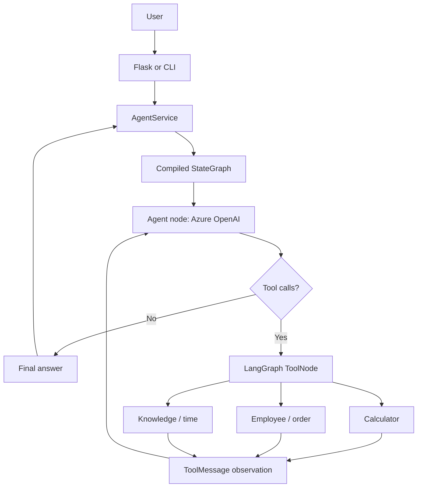
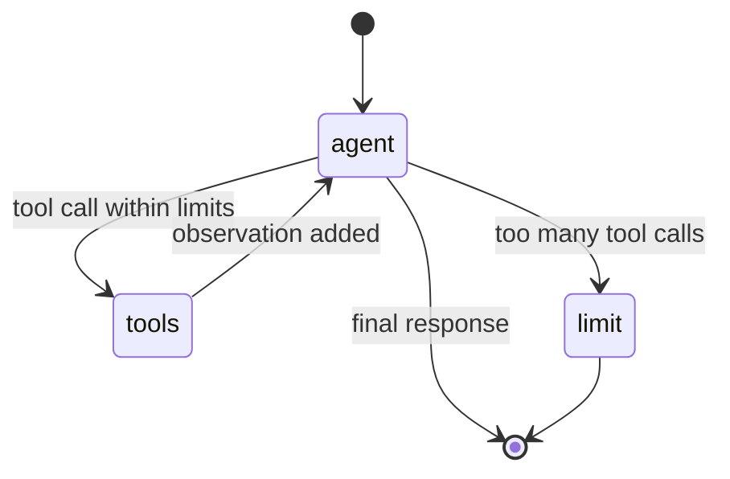
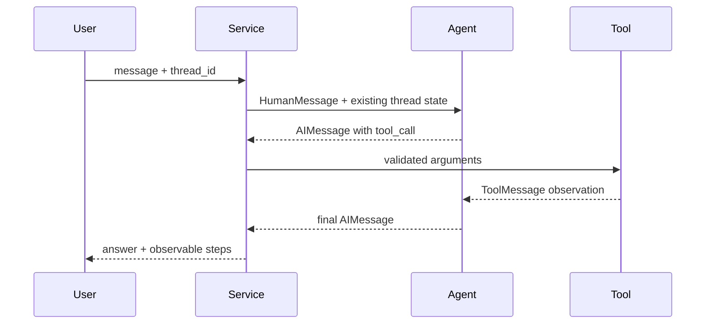
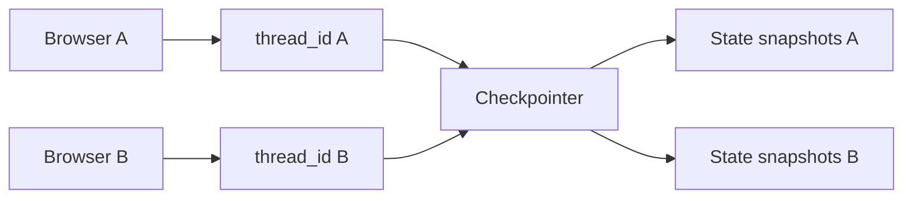
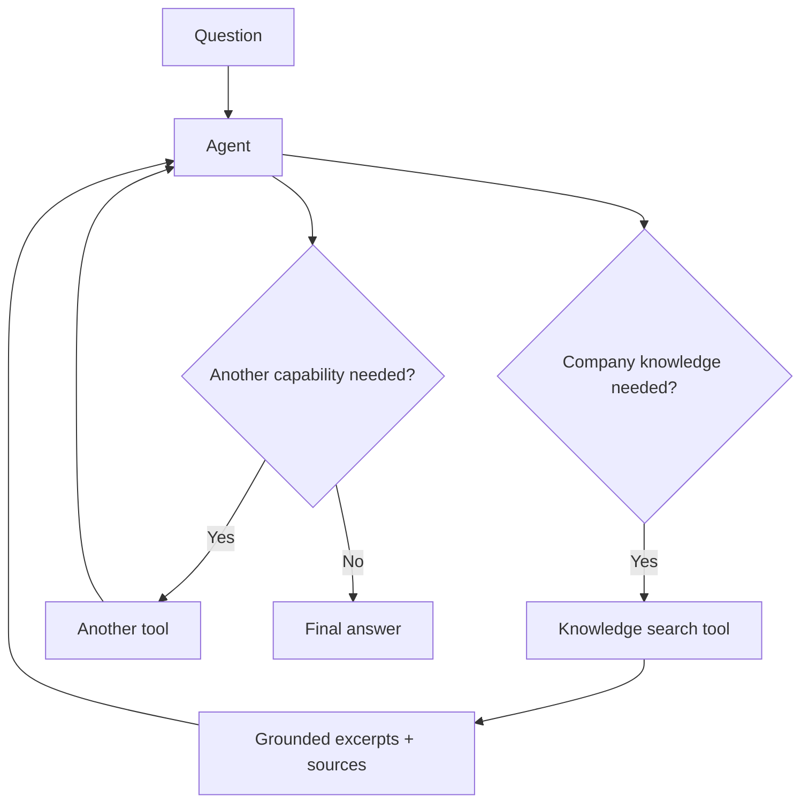

# Architecture

## Design goal

Keep control flow visible. The Flask route does not contain agent logic, tools remain ordinary
Python functions, and the graph has one responsibility: move shared state through explicit nodes.

## Complete request path

The tool branches are capabilities, not a fixed sequence. Azure OpenAI chooses a registered tool;
LangGraph validates and executes the call through `ToolNode`; the resulting `ToolMessage` returns
to the model.

## Compiled graph

Compilation validates the graph definition and produces a runnable object supporting `invoke`,
`stream`, `get_state`, checkpoints, and interrupts. Nodes do not call the next node directly;
edges own that decision.

## Layer responsibilities

| Layer | Receives | Does | Returns |
|---|---|---|---|
| Flask / CLI | User input | HTTP/session or terminal adaptation | Public response |
| `AgentService` | Message + thread ID | Validation, graph invocation, safe result mapping | `AgentResult` |
| Graph | Initial state + config | Nodes, routing, looping, checkpoints | Final state |
| Agent node | Messages + turn state | Calls tool-bound Azure model | `AIMessage` and state update |
| Tool node | `AIMessage.tool_calls` | Validates and executes registered tools | `ToolMessage` observations |
| Tools | Typed arguments | Deterministic business capability | String/JSON observation |
| Checkpointer | State snapshots + thread ID | Short-term thread persistence | Restorable checkpoint |

## State lifecycle

The diagram abbreviates graph scheduling as “Service”; in code, the compiled graph schedules the
agent and tool nodes. Checkpoints are saved at graph super-steps.

`AgentState` contains:

- `messages`: conversation and tool protocol messages, merged by `add_messages`.
- `user_query`: current turn's cleaned input.
- `tool_calls` and `tool_results`: observable records for the current turn.
- `iteration_count`: model decisions in the current turn.
- `current_step`, `steps`, and `errors`: safe operational metadata.
- `final_answer`: the public answer or a guardrail stop message.

Without state, the tool result could not be returned to the model and follow-up turns would not
have conversation context.

## Thread memory and checkpoints

- In-memory mode is process-local and ideal for learning/tests.
- SQLite mode survives restart and is suitable for a single-process local demo.
- Production needs a supported shared database, access controls, concurrency planning, encryption,
  cleanup/retention, and a strategy for application upgrades.

Memory is context supplied again to the model. It is not model training.

## Multi-tool example

“What is E102's salary after a 7% increase?” can produce:

| Step | Node | State change |
|---:|---|---|
| 1 | Agent | Requests `employee_lookup(E102)` |
| 2 | Tools | Adds employee JSON observation with salary 80,000 |
| 3 | Agent | Requests `calculator(80000 * 1.07)` |
| 4 | Tools | Adds `85600` observation |
| 5 | Agent | Adds grounded final answer and stops |

The model decides each next action; the graph still enforces the allowed loop.

## Agentic RAG

Simple RAG always retrieves. Agentic RAG lets the agent choose retrieval and combine it with other
capabilities. That flexibility also adds latency, cost, and failure modes, so use it deliberately.

## Workflow, agent, and multi-agent

| Pattern | Who chooses the path? | Use when |
|---|---|---|
| Workflow | Programmer | Steps are known and auditability is paramount |
| Agent | Model inside graph boundaries | Tool choice must adapt to the request |
| Multi-agent | Supervisor and specialists | Responsibilities/tool contexts are strongly separated |

Examples 12 and 13 intentionally remain small. Multiple agents are not a maturity requirement.
A single agent with five clear tools is easier to evaluate, secure, and operate.

## Human approval

`examples/10_human_in_loop.py` calls `interrupt()` inside an approval node. The checkpointer saves
state and the graph pauses. A later invocation using `Command(resume=True|False)` continues from the
same thread. Side effects should occur only after approval and must be designed for idempotency
because interrupted nodes can replay.

## Failure boundaries

| Failure | Handling |
|---|---|
| Record not found | Tool returns structured `found: false`; agent explains it |
| Invalid tool argument | Tool validation / `ToolNode` produces a safe tool error |
| Repeated tool loop | Iteration and tool-call limits produce a stop response |
| LangGraph recursion limit | Service catches it and returns a safe error |
| Missing Azure configuration | Model factory gives copy/configure instructions |
| Unexpected server error | Flask logs server-side and returns a generic response |

## Why no chain-of-thought

The UI displays node names, requested tools, argument structures, success/error status, and final
answers. That is enough to debug orchestration. It does not request or expose private model
reasoning, system prompts, credentials, or internal token-by-token deliberation.

