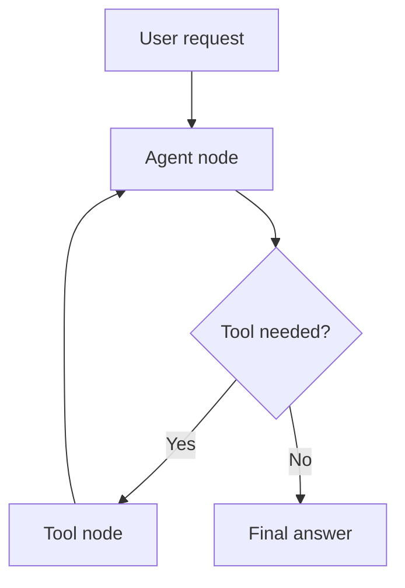

# Stateful AI Agent with Tool Routing and RAG

A working, progressive tutorial for learning **Agentic AI with LangGraph**, Azure OpenAI,
LangChain tools, short-term memory, checkpointing, human approval, optional FAISS retrieval,
a CLI, and a Flask web application.

> **Last verified:** 11 August 2026 against LangGraph 1.2.x, LangChain 1.3.x,
> `langchain-openai` 1.4.x, and Flask 3.1.x. These libraries evolve; consult the linked
> official documentation when upgrading.

## The mental model

> **Agent = LLM + Tools + State + Control Flow**

| Part | Simple meaning | This repository |
|---|---|---|
| LLM | Decides what to do | Azure OpenAI through `AzureChatOpenAI` |
| Tool | Performs an action | Calculator, employee, order, time, knowledge search |
| State | Remembers what happened | `AgentState` and LangChain messages |
| Graph | Controls what happens next | Nodes, edges, routing, loops, checkpoints |

A chatbot usually responds once. An agent may choose a tool, observe its result, update state,
choose another tool, and only then answer.


## Repository map

```text
langgraph-agentic-ai-tutorial/
├── README.md                 # Start here
├── TUTORIAL.md               # 40-part course
├── ARCHITECTURE.md           # Diagrams and design decisions
├── AGENT_CONCEPTS.md         # Plain-English glossary
├── SECURITY.md               # Threats, controls, production checklist
├── app.py                    # Thin Flask adapter
├── src/                      # State, nodes, routing, graph, service
├── tools/                    # Small, safe Python tools
├── data/                     # Sample records, policy, evaluation cases
├── examples/                 # 14 progressive runnable lessons
├── scripts/                  # CLI, inspection, evaluation, cleanup
├── templates/ and static/    # Jinja2, CSS, minimal JavaScript
└── tests/                    # Paid-call-free tests
```

## Prerequisites

- Python 3.11 or newer (3.12 recommended).
- An Azure OpenAI resource and a chat-model deployment that supports tool calling.
- Git. No Node.js, React, Vue, or Angular is required.

## Learn progressively

Start with the offline graph examples. They do not require Azure credentials:

```bash
python examples/02_first_graph.py
python examples/03_state.py
python examples/04_conditional_edges.py
python examples/05_first_tool.py
python examples/07_agent_loop.py
python examples/08_memory.py
python examples/09_checkpointing.py
python examples/10_human_in_loop.py
python examples/11_rag_tool.py
python examples/12_supervisor.py
python examples/13_multi_agent.py
```

After configuring Azure:

```bash
python examples/01_basic_llm.py
python examples/06_tool_calling.py
python examples/14_complete_agent.py
```

Each Azure example prints a setup message and exits cleanly if configuration is missing.

## Run the CLI

```bash
python scripts/run_agent.py
```

Try:

```text
What is employee E102's salary after a 7% increase?
```

The expected loop is `employee_lookup → calculator → final response`.

## Run the Flask application

```bash
python app.py
```

Open [http://127.0.0.1:5000](http://127.0.0.1:5000).

The browser session holds a thread ID. LangGraph's checkpointer associates state with that ID.
Starting a new chat gives the browser a new thread; it does not retrain the model.

## Use the JSON API

```bash
curl -X POST http://127.0.0.1:5000/api/chat \
  -H "Content-Type: application/json" \
  -d '{"message":"What is the status of order ORD-1042?","thread_id":"abc123"}'
```

Example response:

```json
{
  "answer": "Order ORD-1042 has shipped.",
  "thread_id": "abc123",
  "tools_used": ["order_lookup"],
  "iterations": 2,
  "steps": [
    {"type": "received", "status": "success", "tool": null, "details": {}},
    {"type": "tool_call", "status": "success", "tool": "order_lookup", "details": {}},
    {"type": "tool_result", "status": "success", "tool": "order_lookup", "details": {}},
    {"type": "response", "status": "success", "tool": null, "details": {}}
  ],
  "errors": []
}
```

This is an execution trace, not chain-of-thought. Arguments and status are observable protocol
events; private reasoning is not requested, stored, or returned.

## Memory and persistent checkpoints

The default is an in-memory checkpointer: easy to learn, but cleared when the process stops.
For local SQLite persistence, set:

```env
CHECKPOINT_DB_PATH=data/checkpoints/agent.sqlite3
```

The database is intentionally ignored by Git. For production, use a supported database-backed
checkpointer, authentication, authorization, encryption, retention rules, and connection pooling.

## Optional FAISS retrieval

The knowledge tool works immediately with a transparent lexical retriever. To compare it with
semantic FAISS retrieval:

```bash
pip install -r requirements-rag.txt
```

Then set:

```env
USE_FAISS_RAG=true
```

The first run downloads the configured embedding model. RAG is not the whole agent: it is one
capability selected when policy knowledge is needed.

## Debugging and inspection

Set `DEBUG_AGENT=true` to log node names, selected tools, and statuses. Secrets, system prompts,
and chain-of-thought are not logged.

```bash
python scripts/inspect_graph.py
python scripts/inspect_state.py
python scripts/run_evaluation.py
```

## Tests and quality checks

```bash
pip install -r requirements-dev.txt
pytest
ruff check .
```

Tests use fake chat models and local tools. They cover state, routing, tool execution, business
errors, multi-tool loops, iteration limits, thread isolation, SQLite, the service, HTML routes,
and the JSON API without paid calls.

## When not to use an agent

Use deterministic code for CSV conversion, fixed ETL, simple CRUD, basic search, and workflows
whose steps are already known. Add an agent only when dynamic tool choice or iterative decisions
create real value. Many robust systems combine a deterministic outer workflow with a small agentic
decision point.

## Official references

- [LangGraph overview](https://docs.langchain.com/oss/python/langgraph/overview)
- [LangGraph Graph API](https://docs.langchain.com/oss/python/langgraph/graph-api)
- [LangGraph persistence](https://docs.langchain.com/oss/python/langgraph/persistence)
- [LangGraph interrupts](https://docs.langchain.com/oss/python/langgraph/interrupts)
- [AzureChatOpenAI integration](https://docs.langchain.com/oss/python/integrations/chat/azure_chat_openai)
- [Flask documentation](https://flask.palletsprojects.com/)

Continue with [TUTORIAL.md](TUTORIAL.md), then use [ARCHITECTURE.md](ARCHITECTURE.md) and
[AGENT_CONCEPTS.md](AGENT_CONCEPTS.md) as references.

## License

MIT. Sample employee, order, and policy data is fictional and for education only.
