# Complete Agentic AI Tutorial with LangGraph

This course starts with one model call and ends with a stateful, tool-using Flask application.
Run the matching example at each step. Code in `src/` is the complete application; code in
`examples/` isolates one idea at a time.

> Verified 11 August 2026 with LangGraph 1.2.x. The official APIs used here are `StateGraph`,
> `START`, `END`, `ToolNode`, `InMemorySaver`, `SqliteSaver`, `interrupt`, and `Command`.

## How to use this tutorial

For each part, answer eight questions: What is it? Why is it needed? How does it work? Where does
it fit? What enters? What leaves? What happens next? What breaks if it is removed?

Keep this sentence visible:

> **LLM decides. Tool acts. State remembers. Graph controls flow.**

---

## Part 1 — What is Agentic AI?

### What and why

Agentic AI is an application pattern in which a language model can choose actions, receive
observations, and repeat. A normal model call maps input to output once. An agent can make progress
toward a goal whose exact steps are not known in advance.

Personal-assistant analogy: “What is today's sales total?” may be a simple answer. “Find today's
sales and tell me whether we are above target” requires looking up sales, looking up the target,
calculating the difference, and explaining it.

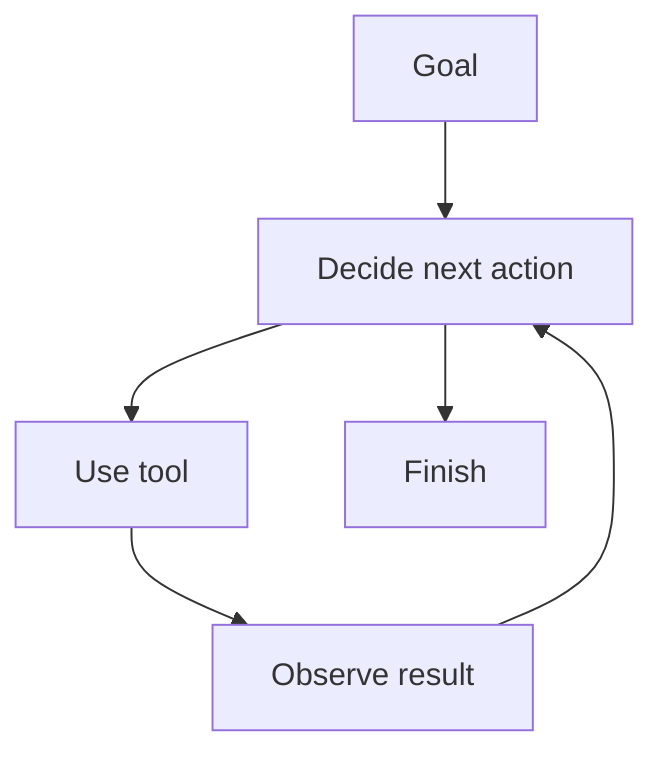

Input is a goal plus available context. Output is a completed answer or a safe stop. Removing the
loop turns this into a one-shot model call. A common mistake is calling any application with an LLM
“agentic”; dynamic action selection and iteration are the important differences.

Expected learning check: you should be able to say, “An agent is a bounded loop around an LLM and
capabilities, not a magical autonomous person.”

## Part 2 — Chatbot vs agent

### What and why

A chatbot is an interaction style; an agent is a control pattern. A chatbot may remember messages
but never act. An agent may be exposed through a chat UI, API, scheduled job, or background worker.

| Chatbot | Agent |
|---|---|
| Often one model response | May take multiple model/tool steps |
| Answers from supplied/model context | Can fetch or act through allowed tools |
| Conversation is central | Goal completion is central |
| Lower latency and complexity | More flexible but costlier and riskier |

Analogy: a receptionist answers questions; an assistant may check calendars, call departments, and
return after collecting facts. Removing tools from this tutorial still leaves a chatbot-like model.
Removing the model's ability to choose leaves a deterministic workflow.

Common mistake: assuming an agent is always better. For “format this date,” ordinary code is safer,
faster, cheaper, and easier to test.

## Part 3 — Workflow vs agent

### What and why

In a workflow, the programmer selects the route. In an agent, the model selects the next capability
inside routes permitted by the programmer. Real systems often combine both.

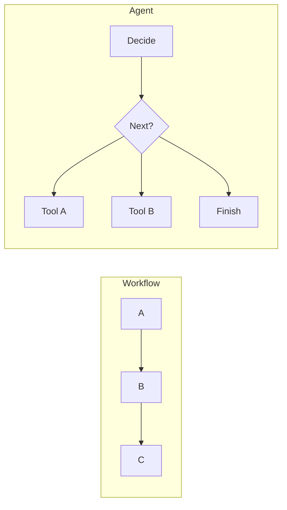

Run:

```bash
python examples/04_conditional_edges.py
```

That example is deterministic: digits route to a calculation branch. Input is state containing a
question; output is the selected branch's answer. If the router is removed, the graph cannot choose
between branches. Common mistakes are using a model for rules that ordinary code can express and,
at the opposite extreme, hard-coding every path when requests genuinely vary.

## Part 4 — What is LangGraph?

### What and why

LangGraph is a low-level orchestration framework for long-running, stateful agents. It represents
the application as state, nodes, and edges. This makes loops, checkpoints, interrupts, and routing
explicit rather than hiding them inside a large prompt or `while` loop.

Analogy: a railway map names stations and permitted connections; trains carry passengers along the
map. Nodes are stations, edges are tracks, and state is the luggage carried between stations.

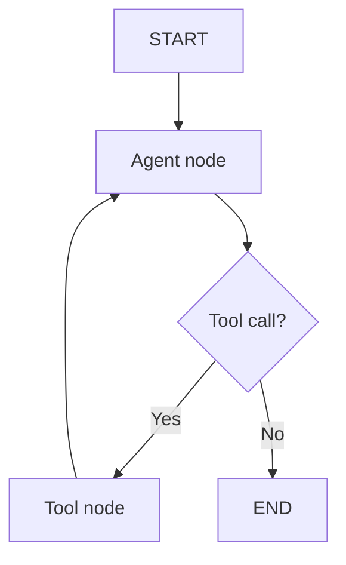

Run `python examples/02_first_graph.py`. Expected output: `Hello, Learner!` If LangGraph is removed,
you can still write the application manually, but you must implement routing, persistence, replay,
and inspection yourself. Common mistake: expecting LangGraph to supply intelligence; the model and
application logic do that. LangGraph supplies control.

## Part 5 — Understanding graphs

A graph is a set of nodes and connections. A LangGraph execution begins at `START` and must reach
`END` or pause at an interrupt. Cycles are allowed, which is why agent loops are natural.

Input: initial state and a runtime config. Output: final state (or interrupt information). Each node
returns a **partial state update**, not necessarily the whole state.

```python
workflow = StateGraph(GreetingState)
workflow.add_node("greet", greet_node)
workflow.add_edge(START, "greet")
workflow.add_edge("greet", END)
graph = workflow.compile()
```

Analogy: a recipe graph tells you which station follows mixing; the bowl contains state. Without
`START`, no entry is defined. Without a path to `END`, execution can continue until a runtime limit.
Common mistakes include orphan nodes, missing terminal paths, and treating a visual diagram as if
it executed code before compilation.

## Part 6 — Nodes

A node is a callable that receives the current state and returns updates.

```python
def greet_node(state):
    return {"message": f"Hello {state['name']}"}
```

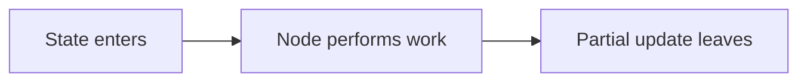

Why: small nodes give each step a clear responsibility and test boundary. In this repository,
`agent` decides, `tools` acts, and `limit` stops. A node may call a model, query a service, validate
data, or perform deterministic logic.

If `agent` is removed, nothing interprets the user's goal. If `tools` is removed, requested actions
are never executed. Mistakes: mutating global data, returning a scalar instead of a state update,
mixing all responsibilities into one node, and putting non-idempotent side effects before an
interrupt.

## Part 7 — Edges

Edges tell LangGraph what can execute next.

- Normal edge: always go from `tools` back to `agent`.
- Conditional edge: call a routing function after `agent` and choose tools, limit, or end.

```python
workflow.add_edge("tools", "agent")
workflow.add_conditional_edges(
    "agent",
    should_continue,
    {"tools": "tools", "limit": "limit", "end": END},
)
```

Input to the router is current state; output is a route name. The graph maps that name to a node.
Analogy: a road sign uses current conditions to choose a destination. Removing `tools → agent`
means the model never sees the observation. Removing the conditional edge means a tool request may
be mistaken for a final response. Debug by printing Mermaid with `python scripts/inspect_graph.py`.

## Part 8 — State

State is the graph's working memory. Open `src/state.py`:

```python
class AgentState(TypedDict, total=False):
    messages: Annotated[list[AnyMessage], add_messages]
    user_query: str
    tool_calls: list[dict[str, Any]]
    tool_results: list[dict[str, Any]]
    iteration_count: int
    final_answer: str | None
```

`add_messages` is a reducer: new messages are merged into the existing list using message IDs.
Other fields describe the current turn and are replaced by updates.

Run `python examples/03_state.py`; expected final value is 30 with history `added 10`, `doubled`.
Analogy: a clipboard travels between team members. Without state, the calculator result is forgotten
before the next model decision. Common mistakes: putting unserializable objects in persistent state,
accidentally accumulating per-turn counters across a thread, and storing secrets or private
reasoning unnecessarily.

## Part 9 — Building your first graph

Run:

```bash
python examples/02_first_graph.py
```

Trace it line by line:

1. Initial state enters at `START`.
2. The normal edge schedules `greet`.
3. `greet_node` reads `name` and returns `message`.
4. The next edge reaches `END`.
5. `invoke` returns the final merged state.

Expected output: `Hello, Learner!`. Input is `{"name": "Learner", "message": ""}`; output contains
the greeting. This first graph has no model, tool, memory, or loop—which proves LangGraph is a
general orchestration layer, not an LLM. Remove `compile()` and you only have a definition, not a
runnable graph.

## Part 10 — Conditional edges

`examples/04_conditional_edges.py` separates classification from route execution. The router is:

```python
def route(state):
    return "calculation" if any(ch.isdigit() for ch in state["question"]) else "general"
```

Why: conditional edges make branching visible and testable. Input is state after `classify`; output
is `calculation` or `general`; the mapped node runs next. Analogy: airport signs route domestic and
international travelers. If removed, both branches need to be buried in one node or the path becomes
fixed. Mistakes: returning a label missing from the mapping and making the router perform expensive
work rather than deciding a route.

## Part 11 — Azure OpenAI setup

Azure OpenAI hosts the model used by the complete agent. `src/llm.py` validates configuration and
creates `AzureChatOpenAI`:

```python
AzureChatOpenAI(
    api_key=...,
    azure_endpoint=...,
    azure_deployment=...,
    api_version=...,
    temperature=0,
)
```

Configure `.env`, then run `python examples/01_basic_llm.py`. The input is one `HumanMessage`; the
output is one `AIMessage`. The deployment must support tool calling for later chapters. The API
version and deployment name are Azure configuration, not LangGraph versions.

Why validation matters: otherwise learners see a distant SDK authentication/deployment error.
Secrets remain server-side. If Azure is removed, offline examples and tools still work, but the
complete dynamic agent cannot decide. Mistakes: committing `.env`, confusing endpoint with a full
chat-completions URL, confusing deployment name with model family, and exposing keys in JavaScript.

## Part 12 — Tool calling

Tool calling is a protocol. The model does not run Python. It returns an `AIMessage` containing a
structured request:

```json
{
  "name": "calculator",
  "args": {"expression": "15% of 360"},
  "id": "call_123"
}
```

LangGraph executes the allowed tool and adds a `ToolMessage` with the same call ID. The model then
receives that observation. Run `python examples/06_tool_calling.py` after Azure setup; it prints the
model's requested calls, not the result, because this chapter stops before ToolNode.

Analogy: a manager fills in a work order; a technician executes it; the completion report returns
to the manager. If the tool-call ID is lost, the observation cannot be matched. Mistakes: parsing
prose as a tool request, trusting unvalidated arguments, and assuming tool support from every model.

## Part 13 — Creating your first tool

Open `tools/calculator.py`. `@tool("calculator")` exposes a name, typed schema, and docstring.

```python
@tool("calculator")
def calculator(expression: str) -> str:
    """Safely calculate arithmetic."""
    return str(calculate_expression(expression))
```

Run `python examples/05_first_tool.py`; expected result is `765`. Input is a string expression;
output is a string observation. The underlying function uses a restricted AST, not `eval`, so tool
arguments cannot execute imports or shell commands.

Why separate the underlying function: it can be unit-tested without LangGraph or an LLM. Analogy:
the decorated function is a machine with a label and an instruction card. Without a useful
description, the model may select the wrong machine. Mistakes: overlapping descriptions, overly
broad tools, arbitrary code execution, and returning enormous results.

## Part 14 — ToolNode

`ToolNode` is LangGraph's standard executor for tool calls found on the last AI message.
`src/nodes.py` wraps it only to record safe activity:

```python
executor = ToolNode(tools, handle_tool_errors=True)
output = executor.invoke(state)
```

Input: state whose last message contains tool calls. Output: one or more `ToolMessage` observations.
Next: the normal edge returns to `agent`. Analogy: a dispatcher reads work orders, calls the named
teams, and attaches their reports.

If ToolNode is removed, you must validate tool names/arguments, execute calls, and construct protocol
messages yourself. That can be appropriate for advanced policy enforcement but adds code. Mistakes:
registering a tool with the model but not ToolNode, swallowing errors without useful observations,
and allowing tools outside the explicit registry.

## Part 15 — Building an agent loop

Run the paid-call-free demonstration:

```bash
python examples/07_agent_loop.py
```

Expected output says `18% of 4250 is 765` and lists received, tool call, tool result, response.

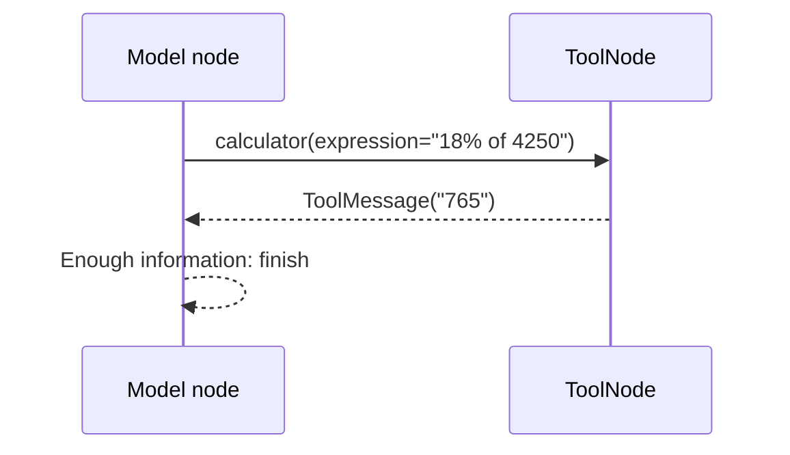

The example uses a scripted model so the control loop is deterministic. The complete app swaps it
for Azure OpenAI without changing the graph. If the `tools → agent` edge is removed, execution ends
with a tool result rather than a natural answer. If the final-route check is removed, the graph may
loop. Debug one transition at a time with state inspection.

## Part 16 — Multiple tool calls

Some goals need observations from several capabilities. For “E102's salary after a 7% increase”:

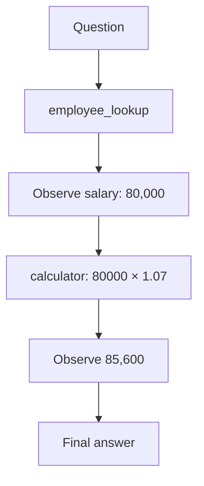

The state after each tool includes the original human message, model request, and ToolMessage. The
next model call sees them. Run `pytest tests/test_graph.py -k multiple`; expected pass proves two
different tools were selected and the final answer is grounded.

Why: the agent can decompose a goal without the programmer hard-coding this specific sequence.
Removing message observations forces guessing. Common mistakes: parallelizing dependent calls,
letting result formats vary wildly, or permitting unnecessary repeated calls.

## Part 17 — Conversation memory

Run `python examples/08_memory.py`. Conversation A remembers a name; conversation B does not.

Memory is previous state supplied again—not training or permanent model knowledge. Input for a new
turn is a new `HumanMessage` plus checkpointed messages. Output is the updated thread state.

Analogy: handing an assistant the previous meeting notes. Without notes, “What department is she
in?” lacks its referent. If memory is removed, every turn becomes isolated. Mistakes: sending an
unbounded history (cost and context pressure), mixing users, storing sensitive data without policy,
and assuming the model remembers when the checkpointer/thread ID changed.

## Part 18 — Thread IDs

A thread ID is the key that keeps conversations separate:

```python
config = {"configurable": {"thread_id": "abc123"}}
graph.invoke(input_state, config)
```

Flask stores one ID in its signed browser session; the CLI generates one UUID at startup. The ID
enters runtime config, not the model prompt. The checkpointer uses it to locate snapshots.

Analogy: a claim number lets support retrieve the right case file. Reusing a thread across users is
a data-leak risk; generating a new ID every turn breaks continuity. Use opaque, unguessable IDs and
authorize access in production.

## Part 19 — Checkpointing

A checkpoint is a saved game for graph state. LangGraph saves snapshots at super-steps when the
compiled graph has a checkpointer.

```python
graph = workflow.compile(checkpointer=InMemorySaver())
```

Run `python examples/09_checkpointing.py`; it prints saved state and a temporary SQLite path. Input
is state plus thread ID; output is both final state and stored snapshots. Checkpoints enable memory,
interrupts, inspection, fault tolerance, and time travel.

Without a checkpointer, the graph still runs but thread memory and interrupts cannot persist.
Mistakes: calling SQLite “production-ready” for a horizontally scaled service, forgetting cleanup,
and placing nonserializable live connections inside state.

## Part 20 — Persistence

In-memory persistence lasts only as long as the Python process. SQLite writes to disk and can survive
a restart. Configure the complete app:

```env
CHECKPOINT_DB_PATH=data/checkpoints/agent.sqlite3
```

`src/checkpoints.py` uses `check_same_thread=False` for this local Flask demo and retains the
connection for the process lifetime. Production should use a supported network database,
connection management, encryption, tenancy filters, migrations, retention, and deletion.

Analogy: a whiteboard is in-memory; a controlled filing system is durable. Remove persistence and
resumable approval disappears after restart. Mistakes: confusing thread-scoped checkpoint state
with cross-user long-term memory and storing more data than policy allows.

## Part 21 — Handling tool errors

Two error classes matter:

- Expected business result: `{"found": false, "error": "Employee not found"}`.
- Unexpected system failure: database unavailable, timeout, corrupted file.

The lookup tools return structured not-found observations so the graph continues and the model can
explain them. ToolNode converts supported execution failures into tool observations. Unexpected
application failures are logged server-side; Flask returns a generic error.

Run `pytest tests/test_graph.py -k business_error`. If expected errors raised through the whole
graph, ordinary “not found” questions would become HTTP 500s. If every exception is hidden, outages
look like empty results. Return safe, typed, actionable distinctions and never expose credentials or
stack traces to users.

## Part 22 — Guardrails

Guardrails are boundaries, not a single product. This app includes:

- user-message and HTTP-size limits;
- an explicit tool allowlist;
- typed tool schemas and input validation;
- no shell or arbitrary code tool;
- safe calculator grammar;
- iteration, tool-call, and recursion limits;
- simulated writes plus human approval concepts;
- generic public errors and secret-safe logs.

Input guardrails run before the graph; execution guardrails run during routing/nodes; tool
guardrails run at the capability boundary. Analogy: roads need speed limits, barriers, and licenses,
not just a careful driver. Remove limits and a model mistake can consume cost indefinitely. Common
mistake: relying on the system prompt as authorization—prompts guide models but cannot enforce
identity or database permissions.

## Part 23 — Preventing infinite loops

An agent may keep calling the same tool because the result is unclear or its prompt says to continue.

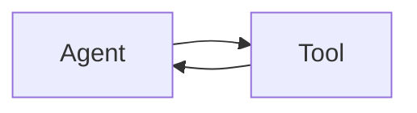

`MAX_AGENT_ITERATIONS`, `MAX_TOOL_CALLS`, and LangGraph's `recursion_limit` provide independent
protection. The limit node returns a helpful response rather than silently truncating.

Run `pytest tests/test_graph.py -k iteration_guardrail`; a deliberately looping fake model stops at
two decisions. Removing these controls risks unbounded latency and spend. Setting them too low can
stop legitimate multi-tool tasks. Observe real step distributions, then choose limits and alerts.

## Part 24 — Human-in-the-loop

Run:

```bash
python examples/10_human_in_loop.py
```

The approval node calls `interrupt(payload)`. The checkpointer saves state and invocation returns
interrupt information. The example resumes with `Command(resume=True)` and prints the simulated
outcome.

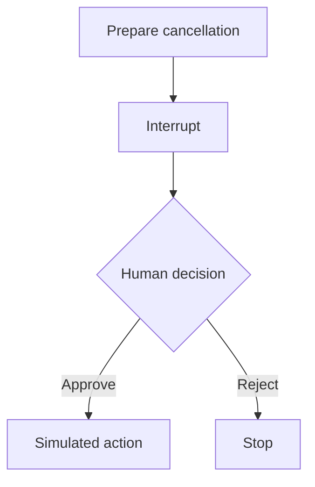

Use approval for payments, deletion, messages, record changes, and other high-impact actions. A
production approval must bind authenticated reviewer, exact payload, scope, and expiry. Nodes can
replay when resumed: place non-idempotent side effects after approval and design them to be safe if
retried. Remove the checkpointer and the graph cannot reliably pause/resume.

## Part 25 — Adding RAG as a tool

RAG retrieves relevant documents and gives excerpts to a model. This repository exposes retrieval
as `knowledge_search`, alongside other tools. Run `python examples/11_rag_tool.py`.

Default retrieval is transparent lexical overlap and works offline. Optional FAISS uses local
embeddings:

```bash
pip install -r requirements-rag.txt
```

```env
USE_FAISS_RAG=true
```

Input is a query; output includes source, chunk, content, and score/distance. The fixed knowledge
directory prevents arbitrary file reads. If sources are removed, grounding cannot be audited.
Mistakes: treating retrieved text as trusted instructions, retrieving too much, omitting source
metadata, and claiming retrieval guarantees truth.

## Part 26 — Agentic RAG

Simple RAG always retrieves. Agentic RAG asks whether retrieval is needed and can combine it with
another tool. The leave example can search policy, look up E102, then calculate remaining days.

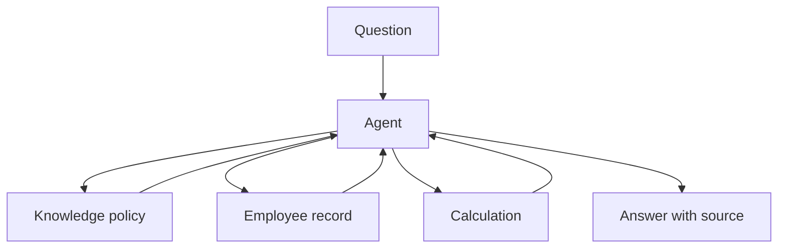

Why: some questions are general and need no retrieval; others need private policy plus operational
data. If the agent decision is unnecessary—for example every question is policy Q&A—simple RAG may
be faster and easier. Common mistakes: calling agentic RAG a replacement for access control and
letting retrieved instructions override the system/tool policy.

## Part 27 — Building a Flask application

`app.py` is an adapter. It receives HTTP input, manages browser session state, calls the shared
service, and renders or returns the result.

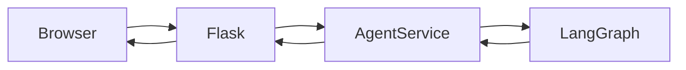

Run `python app.py`, then open `http://127.0.0.1:5000`. Input is a form or JSON request; output is
HTML or JSON. The route does not bind models, execute tools, or implement loops. If the service
boundary is removed, CLI and Flask will duplicate orchestration and drift. Mistakes: creating a new
graph on every request, exposing SDK exceptions, putting secrets in templates, and using Flask's
development server as production infrastructure.

## Part 28 — Building an HTML chat interface

Jinja inheritance starts at `templates/base.html`. `index.html` composes
`conversation.html` and `result.html`. `static/css/style.css` is responsive, and no frontend
framework is required.

Input enters one `<textarea>`; the server renders escaped text by default. Output shows user and
agent bubbles plus observable activity. The browser never receives Azure credentials, system
prompt, checkpoint database, or hidden reasoning.

Analogy: the UI is a dashboard, not the engine. Removing JavaScript still leaves a working HTML
form. Common mistakes: marking model output “safe” and disabling escaping, storing entire sensitive
histories in cookies, and implementing agent logic in the browser.

## Part 29 — Connecting Flask to LangGraph

Both interfaces call:

```python
run_agent(user_message, thread_id)
```

`AgentService` validates input, builds per-thread config, invokes the compiled graph, and maps final
state to `AgentResult`. This result contains answer, thread ID, tool names, observable steps,
iterations, and safe errors.

Input: message and optional thread ID. Output: a stable dictionary/model independent of Flask.
Next: HTML rendering or JSON serialization. If this layer is removed, graph-specific details leak
through every interface. Test it with `pytest tests/test_agent_service.py`.

## Part 30 — Displaying tool activity

The UI may show:

- received question;
- selected tool and structured arguments;
- tool success/error;
- generated response;
- guardrail stop.

It must not show hidden chain-of-thought. Observable events are facts from the orchestration
protocol. They are useful for debugging and user trust without asking the model to narrate private
reasoning.

Input is `AgentState.steps`; output is the activity list. If activity is removed, the agent still
works but is harder to inspect. If raw messages/logs are exposed, secrets and personal data may leak.
In production, apply authorization and redaction even to tool arguments and results.

## Part 31 — Creating a JSON API

`POST /api/chat` accepts:

```json
{"message": "What is the status of order ORD-1042?", "thread_id": "abc123"}
```

It returns the same service result used by HTML. Missing/non-JSON payloads and empty messages return
HTTP 400; unexpected failures return a generic HTTP 500.

Run:

```bash
pytest tests/test_flask_app.py -k json_api
```

Why: integrations should not scrape HTML. If the thread ID is omitted, the service creates one and
the caller must retain it. Production needs API authentication, authorization, rate limiting, CSRF
decisions for cookie-based clients, CORS policy, timeouts, and versioning.

## Part 32 — Testing agents

Separate deterministic and probabilistic concerns.

| Deterministic tests | LLM behavior tests |
|---|---|
| Calculator safety | Correct tool selected? |
| Record lookup | Correct arguments? |
| Router branches | Unnecessary call avoided? |
| Thread isolation | Agent stopped/completed? |
| Flask status/schema | Answer grounded in observations? |

This repository replaces Azure with tiny fake models. Fakes return real `AIMessage.tool_calls`, so
LangGraph and tools still execute. Run `pytest`—no paid call is made.

Exact final strings are brittle for real LLMs. Assert semantic criteria, required facts, tool names,
valid arguments, sources, stop behavior, and limits. Keep a smaller optional live evaluation suite
separate from CI with explicit budget and credentials.

## Part 33 — Evaluating agent behavior

`data/evaluation_cases.json` defines simple queries and expected tools. Run:

```bash
python scripts/run_evaluation.py
```

The offline selector is educational; production evaluation should run the actual configured model
against versioned datasets and measure:

- tool-selection accuracy;
- argument validity/correctness;
- unnecessary calls;
- task completion and groundedness;
- iterations, latency, tokens, cost;
- failure recovery and safe refusal.

Why: unit tests prove code contracts, while evaluations detect behavioral drift after prompt, model,
tool-description, or data changes. Common mistakes: using only happy paths, scoring prose by exact
match, and changing prompt/model without recording evaluation deltas.

## Part 34 — Observability and debugging

Set `DEBUG_AGENT=true`, then run the CLI. Logs contain node, decision category, tool name, and status.
They intentionally exclude credentials, system prompts, hidden reasoning, and full private data.

Useful commands:

```bash
python scripts/inspect_graph.py
python scripts/inspect_state.py
pytest -x -vv
```

Debug one transition: inspect the last message, expected route, resulting ToolMessage, then next
model input. If tools are never called, check registration, descriptions, prompt, model capability,
and message formatting. If the same tool repeats, check observation clarity, state updates, prompts,
and limits. If memory fails, compare thread IDs and checkpointer configuration.

## Part 35 — Workflow patterns

Not every route should be model-controlled. A deterministic outer workflow might classify a request
into order, employee, knowledge, or general nodes; a small agent can operate inside one branch.

Use workflows when rules are stable, audit paths are important, and failures must be predictable.
Use an agent when the sequence genuinely varies. Combine them when governance needs a fixed boundary
around a flexible decision.

If every node is agentic, cost and ambiguity grow. If every decision is hard-coded, natural-language
variation becomes a maintenance burden. `examples/04_conditional_edges.py` shows the deterministic
foundation.

## Part 36 — Supervisor pattern

Run `python examples/12_supervisor.py`. The supervisor classifies one request and routes it to one
specialist.

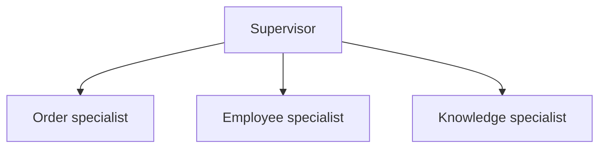

Input is a request; output state names the specialist and answer. A supervisor can be deterministic
or model-driven. Why: reduce tool confusion and give each domain a focused prompt/context. If the
tool set is only five clear capabilities, this extra layer is usually unnecessary. Mistakes: calling
ordinary helper nodes “agents,” allowing endless handoffs, and duplicating data/access rules across
specialists.

## Part 37 — Multi-agent systems

Run `python examples/13_multi_agent.py`. Employee and knowledge specialists place results in shared
state; a supervisor combines them. It is deliberately small and deterministic so responsibilities
are visible.

Single agent: one model owns all tools. Multi-agent: separate agent components own narrower tool
sets/context and communicate through explicit contracts. Consider multiple agents only when domain
separation, prompt specialization, context isolation, or team ownership justifies added latency,
cost, evaluation, permissions, and failure handling.

If a single agent works reliably, keep it. Multi-agent is an architecture trade-off, not an upgrade
badge.

## Part 38 — Security

Read `SECURITY.md`. The central rule is: **the model proposes; trusted code authorizes**.

Validate tool arguments, restrict destructive capabilities, require approval, limit filesystem and
network access, keep credentials server-side, redact logs, protect personal data, and add
authentication before deployment. Retrieved documents and tool outputs can contain prompt injection;
treat them as untrusted data.

Removing access controls means any user who can phrase a request might reach any registered tool.
Prompts cannot replace database row-level authorization. Avoid shell tools and arbitrary file tools
in beginner systems.

## Part 39 — Production considerations

The tutorial separates production topics from beginner code. A production plan needs:

- authenticated identities and tenant-aware authorization;
- shared database-backed checkpoints and retention;
- request/tool timeouts, bounded retries, idempotency, and circuit breakers;
- API gateway controls, rate limiting, quotas, and abuse prevention;
- structured logs, metrics, traces, redaction, alerts, and audit trails;
- horizontal-scaling/session strategy;
- model/tool fallback policy and cost/token monitoring;
- versioned prompts, schemas, datasets, evaluations, and release gates;
- human approval that is authenticated and durable;
- dependency and application security testing.

Do not deploy Flask's debug server publicly. Do not store secrets in source or checkpoints. Do not
assume a model/tool upgrade is behaviorally compatible—re-run evaluations.

## Part 40 — Where to go next

You now have the full flow:

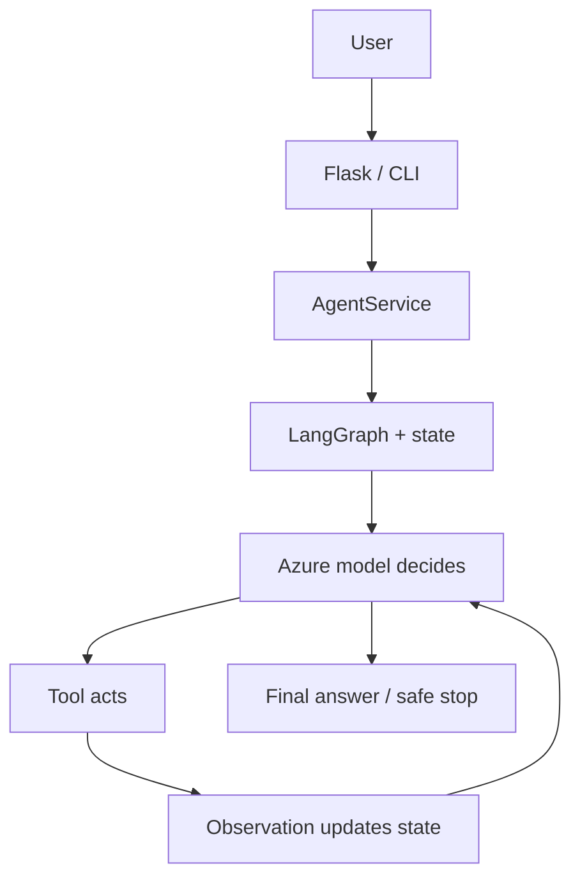

Next exercises, in safe order:

1. Add a read-only customer lookup with tests and a precise description.
2. Add latency and token metadata to safe operational events.
3. Create a versioned live evaluation suite behind an explicit flag/budget.
4. Replace local checkpoints with a supported shared persistence backend.
5. Add authenticated human approval for one simulated write tool.
6. Compare lexical and FAISS retrieval on a labeled knowledge dataset.
7. Only then decide whether specialist subgraphs provide measurable value.

## Final self-check

You should be able to explain:

- Why a tool call is a request, not execution.
- Why `ToolMessage` must return to the model.
- How `add_messages` preserves protocol history.
- How the conditional edge creates the agent loop.
- How a thread ID isolates checkpointed conversation state.
- Why checkpoint memory is not LLM training.
- Why interrupts require persistence and idempotent design.
- Why a simple workflow is often better than an agent.
- Why one reliable agent is often better than many specialists.

If you can explain those points while tracing `src/graph.py`, you understand the core of this
tutorial: **the LLM decides, the tool acts, state remembers, and LangGraph controls what happens
next.**

## Current official references

- [LangGraph overview](https://docs.langchain.com/oss/python/langgraph/overview)
- [Graph API](https://docs.langchain.com/oss/python/langgraph/graph-api)
- [Persistence](https://docs.langchain.com/oss/python/langgraph/persistence)
- [Checkpointers](https://docs.langchain.com/oss/python/langgraph/checkpointers)
- [Interrupts](https://docs.langchain.com/oss/python/langgraph/interrupts)
- [AzureChatOpenAI](https://docs.langchain.com/oss/python/integrations/chat/azure_chat_openai)

